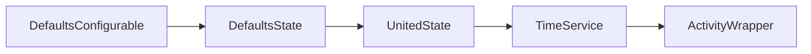

# Requirements

### Behavior
- Add a **Default server / Custom server** selector under Appearance in **Override Defaults**.
- Default mode uses `DEFAULT_ICONS_URL` unchanged. Existing installations retain this behavior.
- Show the server base URL field only in Custom mode; retain its value when switching back to Default.
- Require an absolute HTTP(S) URL with a host, without credentials, query, or fragment. Trim surrounding whitespace and trailing slashes; allow a base path.
- Persist the choice application-wide and use it for every IDE and language icon on the next activity render after Apply.
- Preserve normal Apply, Reset, and modification detection behavior.

### Scope
No project-specific override, server availability probe, automatic network failover, icon-path changes, or Discord reconnection changes. Custom servers must serve the existing icon directory layout.

# Technical Design

### Existing Pattern
`CatActivitySettingAppState` persists `DefaultsState` in `cat-activity-defaults.xml`. `DefaultsConfigurable` uses IntelliJ UI DSL bindings; `ProjectConfigurable` demonstrates conditionally enabled controls. `TimeService.render()` creates a fresh `UnitedState` for each render, while its `getIDEIconUrl()` and `getLangIconUrl()` currently hardcode the constant.

### Changes and Contracts
- Add `useCustomIconsServer: Boolean = false` and `customIconsUrl: String = ""` to `DefaultsState`. Resolve a normalized effective base URL, falling back to `DEFAULT_ICONS_URL` for invalid persisted custom values; UI validation prevents applying invalid custom input.
- Add `iconsUrl: String` to `UnitedState`, populated from defaults only. This preserves the existing settings-to-render flow rather than introducing another service or direct settings lookups inside URL builders.
- Bind the selector and URL field in `DefaultsConfigurable`; show, enable, and validate the field only in custom mode. Use localized messages and explain that the server must mirror the existing icon layout.
- Pass `configState.iconsUrl` explicitly through `TimeService.applyIDEInfo()` and `applyFileInfo()` into both URL builders. Keep suffixes unchanged: `/{theme}/{icon}.webp`, `/IDE/new/{theme}/{icon}.webp`, and `/IDE/{theme}/{icon}.webp`. Update file, idle, project, and IDE rendering branches, including both large and small images.
- Keep `Consts.kt` and `CatSettingState.kt` unchanged: the existing constant and bean persistence already support this design.

### File Structure
Paths below are relative to `src/`:
- Modify `main/kotlin/cat/wavy/catactivity/setting/DefaultsState.kt`, `DefaultsConfigurable.kt`, and `UnitedState.kt`.
- Modify `main/kotlin/cat/wavy/catactivity/service/TimeService.kt`; keep URL construction testable through package-internal pure functions in this file if needed.
- Modify `main/resources/messages/ConfigBundle.properties` and `ConfigBundle_en.properties` with matching labels, help, and validation messages.
- Add `test/kotlin/cat/wavy/catactivity/setting/IconsServerSettingsTest.kt` and `test/kotlin/cat/wavy/catactivity/service/IconUrlsTest.kt`, following existing JUnit 4 conventions.

### Settings Flow

The server prefix is resolved once per render snapshot, so all icons in an activity use the same saved selection.

# Testing

### Automated Checks
- Test default and legacy state behavior, custom selection, switching back to default, and persistence round-trip using IntelliJ XML serialization.
- Test whitespace/trailing-slash normalization, base paths, and rejection of blank, relative, malformed, or unsupported URLs.
- Test language icons and every `IDEIcon` variant against default and custom prefixes, preserving existing suffixes.
- Check UI binding behavior for Apply, Reset, modification detection, and custom-only validation with IntelliJ platform tests.
- Build the project, inspect changed Kotlin files, and run the JUnit suite. Verify every rendering call site receives the resolved URL; no live icon server or Discord connection is needed.

# Delivery Steps

### ✓ Step 1: Persist and resolve icon-server preferences
Application defaults expose a backward-compatible, normalized effective icon-server URL.
- Extend `DefaultsState` with the custom-mode flag, retained URL, and shared URL validation/resolution logic.
- Add the resolved `iconsUrl` to `UnitedState` using the existing defaults snapshot flow.
- Add `IconsServerSettingsTest` coverage for legacy defaults, mode switching, URL edge cases, and XML persistence.

### ✓ Step 2: Add icon-server controls to Override Defaults
Override Defaults lets users select and save a valid default or custom server.
- Extend the Appearance group in `DefaultsConfigurable` using existing UI DSL bindings and conditional enablement patterns.
- Enable URL validation only in custom mode; retain the custom value when disabled.
- Add matching labels, layout help, and validation messages to both `ConfigBundle` resource files.
- Cover Apply, Reset, and modification detection with platform tests.

### ✓ Step 3: Use the selected server throughout activity rendering
Every IDE and language icon generated by TimeService uses the saved server prefix.
- Thread `UnitedState.iconsUrl` through `applyIDEInfo`, `applyFileInfo`, and both URL builders in `TimeService`.
- Update file, idle, project, and IDE branches without changing icon suffixes or image swapping behavior.
- Add `IconUrlsTest` coverage for language icons, all IDE variants, and custom base paths.
- Build, inspect changed files, and run the test suite to validate the complete change.

### ✓ Step 4: Show the custom URL only for the custom server
Hide the entire custom-server URL row in Default mode and show it in Custom mode, preserving the saved URL and existing bindings.