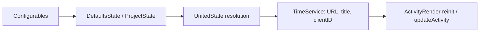

# Requirements

### Behavior
- The **IDE icon** selector gains a **Custom** option in both settings pages: the main project page ("Cat Activity") and **Override Defaults**.
- Selecting **Custom** reveals: **Application ID** field; a hint link below it (create an application in the Discord Developer Portal, `https://discord.com/developers/applications`); required **Application title** field; **Icon variant** selector with the same entries as `IDEIcon.entries` (New / Old / JetBrains / Cat Activity / Custom); when variant = Custom, a **Custom icon URL** field.
- **Override Defaults**: Application ID, title, and (for Custom variant) URL are mandatory; Apply is blocked with inline errors otherwise.
- **Project page**: fields are optional; blank values and `Default` variant inherit from Override Defaults. Non-blank values must be valid; effective (resolved) values must satisfy the Custom requirements, otherwise Apply is blocked.
- **Application ID validation (strict)**: digits only, 17-20 characters, must fit into `Long` (Discord snowflake).
- **Custom icon URL validation**: absolute HTTP(S) URL with a host; credentials and fragments rejected; query parameters allowed.
- **Runtime**: resolved Application ID drives the Discord SDK connection (project reinit on change); resolved title is the large-image tooltip (`largeImageText`); resolved variant/URL is used for the large icon and for the small icon in File mode.
- **Apply in Override Defaults re-renders all open non-default projects** so a new Application ID reconnects immediately.
- Invalid values persisted manually in XML never break rendering: fall back to the current IDE's Application ID/title and the standard New icon.

### Scope
- Only the existing bundles are updated (`ConfigBundle.properties` and `ConfigBundle_en.properties`).
- Out of scope: checking that the Application ID exists on Discord, managing app assets on the portal, README/docs updates, new locales.

# Technical Design

### Existing Pattern
- `IDEIcon` / `IDEIconDefaultable` enums pair an icon with an `IDEType` (app ID + title); `UnitedState` is a fresh merge snapshot of project + app defaults per render; `TimeService.render()` reinits `ActivityRender` when `clientID` changes; the custom-icon-server feature (commit `490acf3`) is the reference for Custom UI + `validationOnApply` + conditional rows.
- UI: Kotlin UI DSL v2; conditions from `com.intellij.ui.layout` (`visibleIf`, `selectedValueMatches`, combinable with `and`). Persistence: `XmlSerializerUtil.copyBean`, so new fields with defaults are backward/forward compatible.

### Changes and Contracts
1. **Enums** (`setting/DefaultsState.kt`, `setting/ProjectState.kt`):
   - `IDEIcon.app: IDEType` -> `IDEType?`; add `Custom("Custom", null)`.
   - `IDEIconDefaultable`: add `Custom("Custom", null)`.
   - These same enums are reused for the icon variant selector (project variant additionally has `Default` = inherit).
2. **State fields** (defaults keep old behavior):
   - `DefaultsState`: `customApplicationId = ""`, `customApplicationTitle = ""`, `customIconVariant: IDEIcon = IDEIcon.New`, `customIconUrl = ""`.
   - `ProjectState`: same strings; `customIconVariant: IDEIconDefaultable = IDEIconDefaultable.Default`.
3. **Validation helpers** (top-level `internal` in `DefaultsState.kt`, next to `normalizeUrl`):
   - `parseApplicationId(String): Long?` / `isValidApplicationId(String): Boolean` - trim, `^\d{17,20}$`, `toLongOrNull()`.
   - `normalizeIconUrl(String): String?` - trim; absolute HTTP(S), host required, no userinfo/fragment; **query allowed**. `normalizeUrl` (server) stays unchanged.
4. **`UnitedState`** - replace `ideIcon: IDEIcon` with resolved fields: `applicationId: Long`, `applicationTitle: String`, `iconVariant: IDEIcon`, `customIconUrl: String?`:
   - Not Custom -> ID/title from `icon.app` (fallback `currentIDEType`), variant = icon, URL = null.
   - Custom -> project value `ifBlank` -> default value; variant `Default` -> defaults' variant; URL only when effective variant = Custom; invalid/missing values fall back to `currentIDEType` ID/title and New icon.
   - `resolveIDEIcon` exhaustive `when` gains `Custom`.
5. **`TimeService`**:
   - `buildIDEIconUrl(iconVariant, customIconUrl, theme, iconsUrl)`; `IDEIcon.Custom` -> custom URL (New URL as a safety fallback).
   - `applyIDEInfo`/`applyFileInfo` accept `UnitedState` (title = `applicationTitle`); all four call sites updated.
   - Reinit check uses `configState.applicationId`; `ActivityRender` keeps its default `clientID = currentIDEType.applicationId` and switches on first render.
6. **UI**:
   - `DefaultsConfigurable`: rows after IDE icon, `visibleIf(ideIcon == Custom)` - Application ID (validationOnApply), link row (`BrowserUtil.browse`), Application title (validationOnApply non-blank), Icon variant combo; URL row visibility = combined condition (`selectedValueMatches` on both combos joined with `and`), validationOnApply only when effective variant Custom. `apply()` additionally renders open non-default projects via `ProjectManager`.
   - `ProjectConfigurable`: same rows using `IDEIconDefaultable`; `emptyText = leaveBlankDefaultValue` on text fields; validation resolves effective values from `CatActivitySettingAppState` (project `ifBlank` -> defaults); variant `Default` inherits.
7. **Bundles** (both files): `customApplicationId`, `customApplicationTitle`, `customIconVariant`, `customIconUrl`, `createApplicationLink`, `invalidApplicationId`, `emptyApplicationTitle`, `invalidCustomIconUrl`, plus a short tooltip help for title.

### File Structure
- Modify: `src/main/kotlin/cat/wavy/catactivity/setting/{DefaultsState,ProjectState,UnitedState,DefaultsConfigurable,ProjectConfigurable}.kt`, `service/TimeService.kt`, `src/main/resources/messages/ConfigBundle.properties`, `ConfigBundle_en.properties`.
- Add: `src/test/kotlin/cat/wavy/catactivity/setting/CustomApplicationValidationTest.kt`.
- Unchanged: `render/ActivityRender.kt` (only its default clientID is used as a fallback), `CatSettingState.kt`, `types/IDEType.kt`, `plugin.xml`.

### Settings Flow

# Testing

### Automated Checks
- Plain JUnit 4 tests (no platform deps) for the pure helpers: snowflake acceptance (17-20 digits) and rejection (blank, non-digit, too short/long, Long overflow); `normalizeIconUrl` acceptance (HTTP/HTTPS, port, base path, query) and rejection (relative, ftp, userinfo, fragment, blank); `normalizeUrl` regression unchanged. `UnitedState`/`IDEIcon` tests are intentionally not added - enum init touches `currentIDEType`, which requires the platform runtime.
- `.\gradlew.bat check` (compile + tests) and `.\gradlew.bat verifyPlugin`.
- Sandbox smoke test via `.\gradlew.bat runIde`: open both settings pages, exercise validation, Apply re-render, inheritance, and File-mode icon swap.

# Delivery Steps

### Step 1: Settings model and validators
Enums and both state classes support custom app values; validation helpers exist and are unit-tested.
- Extend `IDEIcon`/`IDEIconDefaultable`; add state fields; add `parseApplicationId`/`isValidApplicationId`/`normalizeIconUrl`; add `CustomApplicationValidationTest`.

### Step 2: Resolution and runtime wiring
Custom values reach Discord: app ID/title/icon are resolved and applied per render.
- Extend `UnitedState` resolution (inheritance + fallbacks); rework `buildIDEIconUrl`, `applyIDEInfo`, `applyFileInfo`, and the `clientID` reinit check in `TimeService`.

### Step 3: Override Defaults UI
Custom controls with validation and an immediate effect.
- Add conditional rows + link + validation to `DefaultsConfigurable`; re-render open projects on apply; add bundle keys to both files.

### Step 4: Project settings UI
Overrides with blank/`Default` inheritance.
- Add the same rows to `ProjectConfigurable` using `IDEIconDefaultable`, `leaveBlankDefaultValue`, and effective-value validation.

### Step 5: Verification
Build, tests, and manual smoke checks pass; bundle keys resolve.
- Run `.\gradlew.bat check` and `.\gradlew.bat verifyPlugin`; smoke-test in `runIde`.
